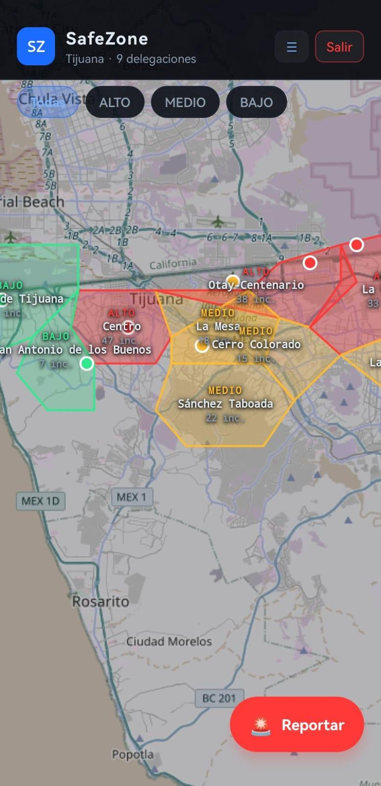
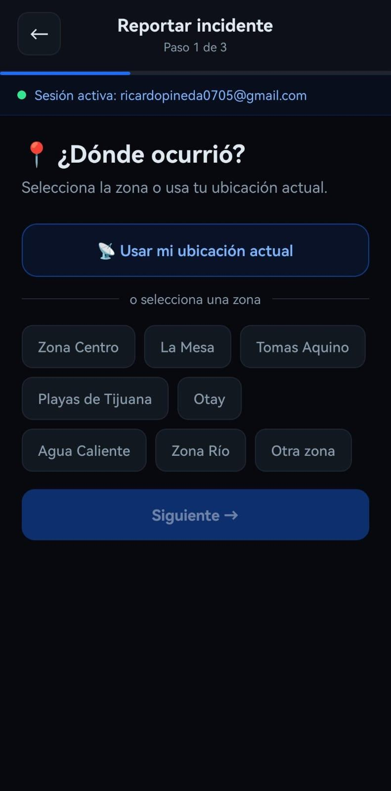
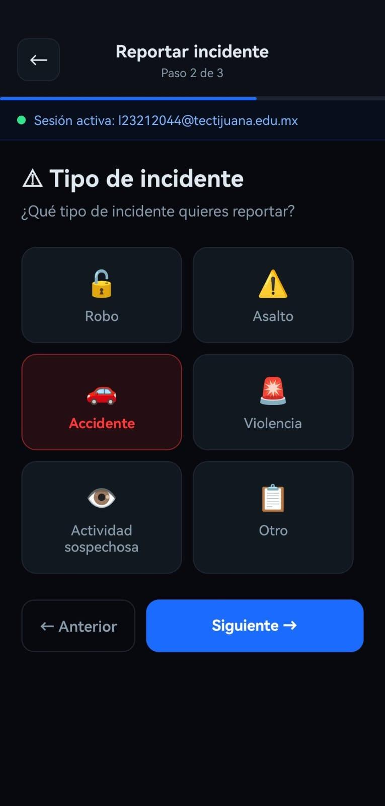
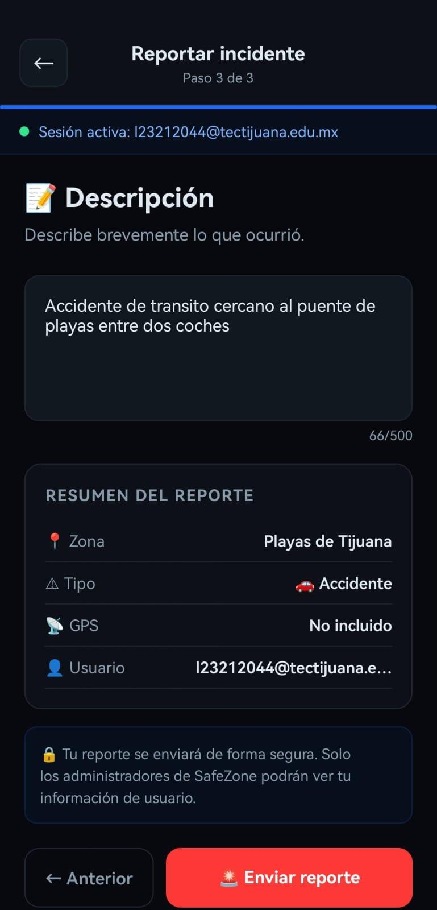
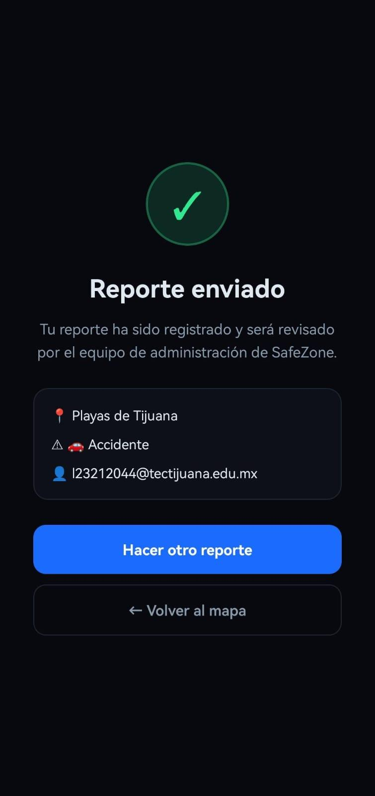
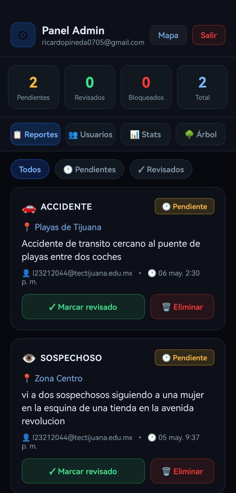
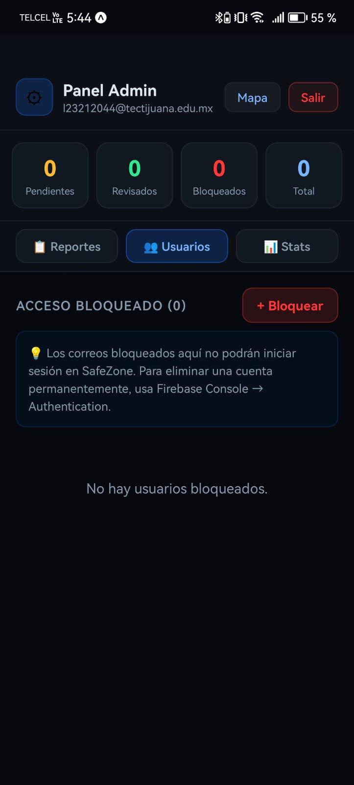
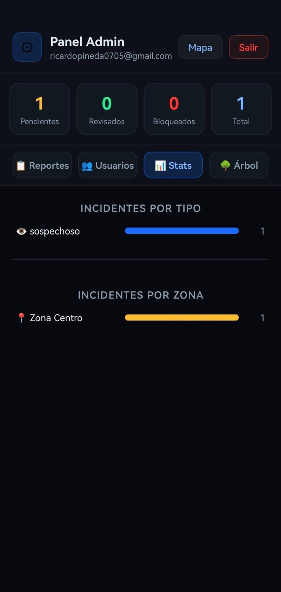
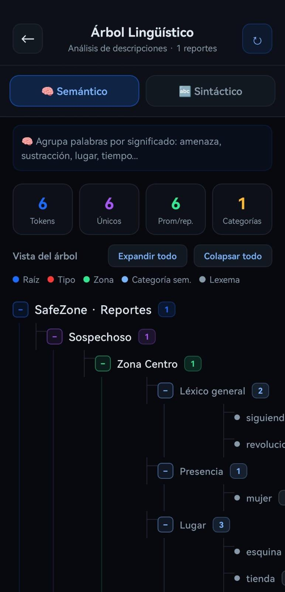
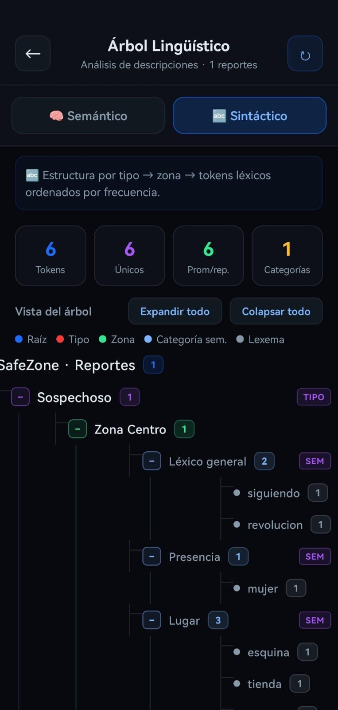

# SafeZone

Aplicación móvil (Expo / React Native) y API (Express + MySQL) para reportar incidentes y consultar el índice de riesgo por delegación en Tijuana.

El proyecto usa **únicamente MySQL** para persistencia y autenticación con **bcrypt + JWT**.

## Estructura

```text
safezone/                 App Expo / React Native
  src/config/             authService.ts, riskEngine.ts
  src/screens/            Login, Map, Report, Admin, RiskDashboard, Tree
  assets/                 Íconos y splash
safezone-api/             API Express + MySQL
  index.js                API principal (reportes, índice, salud)
  authRoutes.js           Registro, login, JWT, panel admin
  schema.sql              Base de datos, tablas y datos iniciales
  .env.example
docs/screenshots/         Capturas reales tomadas de los PDF de manuales
manuales/                 PDF de manual de usuario y proyecto
```

## Paleta

La interfaz usa la paleta oscura con acento verde de SafeZone: fondo `#0a0a0a`, superficies `#111111`, acento `#2ECC71`, éxito `#27AE60`, advertencia `#E67E22` y peligro `#E74C3C`. `safezone/recolor.js` conserva el mapeo usado para normalizar los colores.

## Base de datos MySQL

```bash
mysql -u root -p < safezone-api/schema.sql
```

El esquema crea `safezone_db` con las tablas `delegaciones`, `tipos_incidente`, `usuarios`, `reportes`, `indice_riesgo`, `usuarios_bloqueados` y `logs_acceso`, además de las 9 delegaciones y los pesos por tipo de incidente.

También puedes crear un usuario dedicado:

```sql
CREATE USER 'safezone_app'@'localhost' IDENTIFIED BY 'TU_PASSWORD';
GRANT ALL PRIVILEGES ON safezone_db.* TO 'safezone_app'@'localhost';
FLUSH PRIVILEGES;
```

Para habilitar un administrador, regístralo desde la app y ejecuta:

```sql
UPDATE usuarios SET rol = 'admin' WHERE email = 'tu-correo@dominio.com';
```

## API

```bash
cd safezone-api
cp .env.example .env
npm install
npm start
```

Variables principales de `.env`: `DB_HOST`, `DB_PORT`, `DB_USER`, `DB_PASSWORD`, `DB_NAME`, `PORT`, `JWT_SECRET` y `ADMIN_CODE`.

Endpoints principales:

| Método | Ruta | Descripción |
| --- | --- | --- |
| `GET` | `/ping`, `/health` | Estado de la API y MySQL |
| `POST` | `/auth/register`, `/auth/login` | Alta e inicio de sesión (JWT) |
| `GET` | `/delegaciones` | Delegaciones activas |
| `GET` | `/reportes` | Reportes recientes (requiere token) |
| `POST` | `/reportes` | Crear reporte y recalcular índice |
| `PATCH` / `DELETE` | `/reportes/:id` | Revisar o archivar reporte (admin) |
| `GET` | `/indice-riesgo` | Índice mensual por delegación |
| `POST` | `/indice-riesgo/recalcular` | Recalcular todas las delegaciones |
| `GET` | `/admin/usuarios`, `/admin/bloqueos`, `/admin/logs` | Panel de administración |

El índice se calcula sobre un máximo de 120 puntos: `<30%` bajo, `30–65%` medio y `>65%` alto. Se reinicia cada mes con `periodo_inicio`.

## App móvil

```bash
cd safezone
cp .env.example .env
npm install
npm start
```

Define `EXPO_PUBLIC_API_URL` con la IP local de la PC (por ejemplo `http://192.168.1.56:3001`). El valor por defecto está en `src/config/authService.ts`.

Scripts: `npm start`, `npm run android`, `npm run ios`, `npm run web`, `npm run typecheck`.

## Capturas reales

Tomadas de los PDF incluidos en `manuales/` (`U3. DESARROLLO (MANUALES DE USUARIO Y ADMINISTRADOR).pdf` y `PROYECTO FINAL.pdf`).

| Login | Mapa de riesgo |
| --- | --- |
|  |  |

| Reporte · paso 1 | Reporte · paso 2 | Reporte · paso 3 |
| --- | --- | --- |
|  |  |  |

| Reporte enviado | Panel admin · reportes |
| --- | --- |
|  |  |

| Admin · usuarios | Admin · estadísticas |
| --- | --- |
|  |  |

| Árbol semántico | Árbol sintáctico |
| --- | --- |
|  |  |
